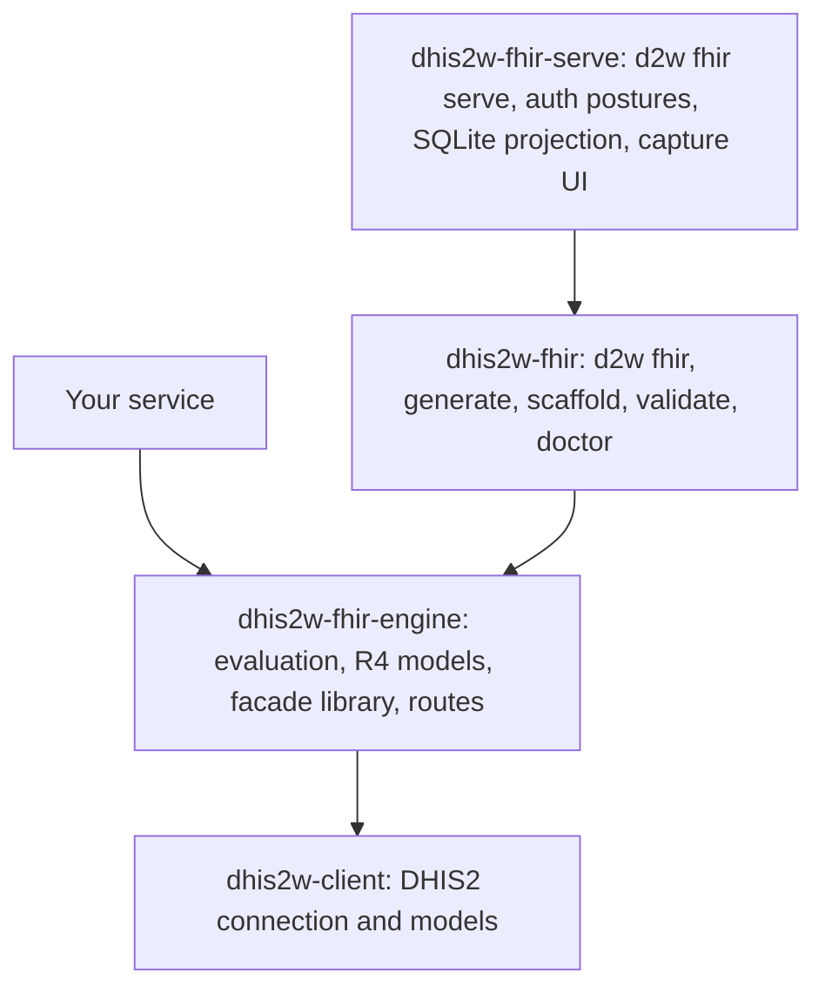
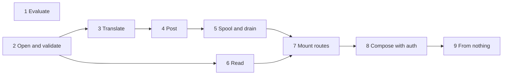

# Compose a facade

**Who this is for:** the developer building a FHIR-to-DHIS2 service who wants to write the service and not the facade
under it.

**Before you start:** Python 3.13, `uv`, and a DHIS2 you can reach.

**You will be able to:**

- start a service from `uv init` with no `fhir.toml`, no SUSHI, and no docker
- use any one piece on its own, from a single expression up
- mount `/metadata`, capture, and reads in your own FastAPI application without writing them
- put all of it behind your own authentication

**The runnable version of this page** is [`examples/facade/`](https://github.com/winterop-com/dhis2w-fhir/tree/main/examples/facade):
nine small steps, each using what the one before it showed.

## From nothing

```console
$ uv init myfacade && cd myfacade
$ uv add dhis2w-fhir-engine uvicorn
```

```python
from collections.abc import AsyncGenerator
from contextlib import asynccontextmanager
from pathlib import Path

from dhis2w_client import BasicAuth, Dhis2Client
from dhis2w_fhir_engine.facade import FacadeConfig, open_facade
from dhis2w_fhir_engine.facade.api import attach_facade, mount_facade
from fastapi import FastAPI

config = FacadeConfig(canonical="http://example.org/fhir/demo", root=Path(".facade"))


@asynccontextmanager
async def lifespan(app: FastAPI) -> AsyncGenerator[None]:
    auth = BasicAuth(username="admin", password="district")
    async with Dhis2Client(base_url="http://localhost:8080", auth=auth) as client:
        async with open_facade(config, client=client) as facade:
            attach_facade(app, facade)
            yield


app = FastAPI(lifespan=lifespan)
mount_facade(app)
```

```console
$ uv run uvicorn main:app
```

That is a FHIR facade: `/metadata`, read and search over the forms and the register, `$generate`, and
`POST /QuestionnaireResponse`. With no compiled guide, `open_facade` builds the guide off the instance as it starts.

## Which package holds what



You install the engine. `dhis2w-fhir` is what you add to publish an Implementation Guide, and `dhis2w-fhir-serve` is
the finished server, UI included, for when you want to run a facade rather than build one.

## The path through the pieces

Each step works on its own, so stop at the one your service needs.



| Step | What you call | What it is for |
| --- | --- | --- |
| [1](https://github.com/winterop-com/dhis2w-fhir/blob/main/examples/facade/step1_evaluate.py) | `FHIRPathEvaluator`, `CQLEvaluator` | Computing over FHIR data, with no DHIS2 at all |
| [2](https://github.com/winterop-com/dhis2w-fhir/blob/main/examples/facade/step2_validate_a_capture.py) | `open_facade`, `Facade.validate_capture` | Whether a submission meets the published forms |
| [3](https://github.com/winterop-com/dhis2w-fhir/blob/main/examples/facade/step3_translate.py) | `Facade.translate` | The DHIS2 payload a response means, with no network |
| [4](https://github.com/winterop-com/dhis2w-fhir/blob/main/examples/facade/step4_post.py) | `Facade.post` | DHIS2's verdict on a payload, under validate-only by default |
| [5](https://github.com/winterop-com/dhis2w-fhir/blob/main/examples/facade/step5_spool_and_drain.py) | `Facade.capture`, `Facade.drain` | Receipts that survive DHIS2 being away, and the drain `d2w fhir forward` runs |
| [6](https://github.com/winterop-com/dhis2w-fhir/blob/main/examples/facade/step6_read.py) | `Facade.store`, `load_terminology`, `registered_entity_for` | The guide, its codes, and a person out of DHIS2 as FHIR |
| [7](https://github.com/winterop-com/dhis2w-fhir/blob/main/examples/facade/step7_mount_metadata_and_capture.py) | `mount_facade`, `attach_facade` | The routes, beside your own |
| [8](https://github.com/winterop-com/dhis2w-fhir/blob/main/examples/facade/step8_compose_with_authentication.py) | `mount_facade(authentication=...)` | Your credential in front of all of it |
| [9](https://github.com/winterop-com/dhis2w-fhir/blob/main/examples/facade/step9_from_nothing.sh) | `uv init`, `uv add` | All of the above from an empty directory |

## What mounting does for you

`mount_facade` takes one flag per surface: `metadata`, `capture`, `reads`, and `operations`, plus `facade_api` for a
prefix to mount the operational JSON API under, which stays out unless you name one.

- **`/metadata` states what was mounted.** A surface you left out is neither served nor declared.
- **Declare your own routes first.** The reads claim every one-segment path, so `mount_facade` puts them last, and a
  route added after it is a route they already claimed.
- **Every refusal is an `OperationOutcome`,** including one your own dependency raises.
- **`authentication` guards everything but `/metadata`,** because a client has to be able to read the posture it is
  expected to meet.
- **Under a router prefix, pass `service_base` to `attach_facade`,** since the request cannot say where the facade
  is. An ASGI mount carries its path into every link on its own.

## A guide off disk instead

With a compiled guide under `root` at `ig/fsh-generated/resources`, or a published guide's `package.tgz` given as
`FacadeConfig(package=...)`, `open_facade` reads that and needs no client. Validation and translation then run with no
network at all, and a call that needs DHIS2 refuses with `NoDhis2ConnectionError`. A project with a `fhir.toml` passes
its `FhirProject` to `open_facade` in place of the settings.

Next: [Embed the facade](401-embed-the-facade.md) for `create_app` and the rest of the served facade as a library,
[The capture contract](401-capture-contract.md) for what a valid submission is, and the
[`dhis2w_fhir_engine` API reference](api-dhis2w-fhir-engine.md) for every name on this page.
