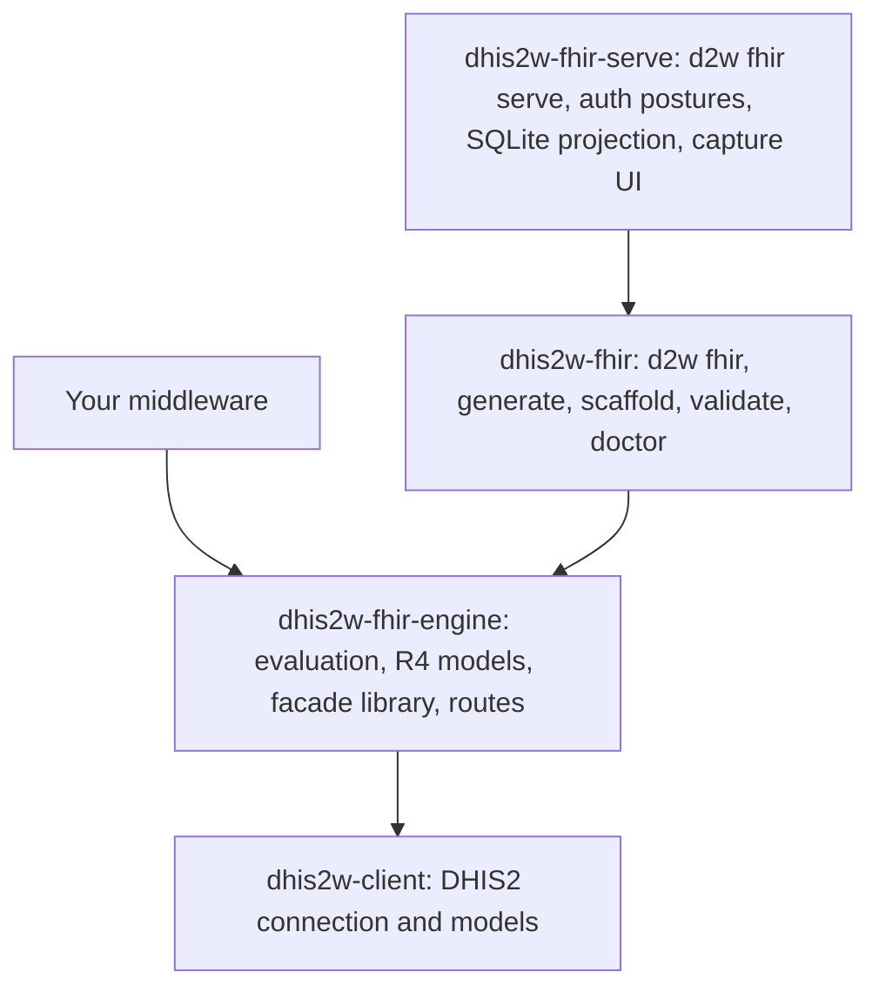
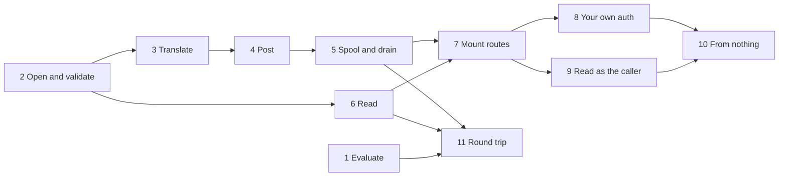

# Build a middleware

**Who this is for:** the developer building a service that sits between another system and DHIS2: it takes FHIR from one
side and reads and writes DHIS2 on the other, inside an application of your own.

**Before you start:** Python 3.13, `uv`, and a DHIS2 you can reach. You need no project, no compile, and no docker.

**You will be able to:**

- start a working service from an empty directory
- say which package to install, and which you do not need
- find the page for each thing a middleware does

**The runnable version of this section** is
[`examples/facade/`](https://github.com/winterop-com/dhis2w-fhir/tree/main/examples/facade): eleven small steps, each using
what the one before it showed.

## Do you need one?

| You want | Use |
| --- | --- |
| A finished FHIR server, with capture screens, that you run and configure | [`d2w fhir serve`](201-serve.md) |
| Your own service, with your own routes, login, and deployment | This section |
| To compute over FHIR data, with no DHIS2 involved | [FHIRPath](501-fhirpath.md), [CQL](501-cql.md), and [quality measures](501-measures.md) |
| To call a facade somebody else runs | [Consume the FHIR API](401-consume-the-fhir-api.md) |

## From nothing

```console
$ uv init myfacade && cd myfacade
$ uv add dhis2w-fhir-engine uvicorn
```

Put this in `main.py`:

```python
from collections.abc import AsyncGenerator
from contextlib import asynccontextmanager
from pathlib import Path

from dhis2w_client import BasicAuth, Dhis2Client
from dhis2w_fhir_engine.facade import FacadeConfig, open_facade
from dhis2w_fhir_engine.facade.api import attach_facade, mount_facade
from fastapi import FastAPI

config = FacadeConfig(canonical="http://example.org/fhir/demo", root=Path(".facade"))


@asynccontextmanager
async def lifespan(app: FastAPI) -> AsyncGenerator[None]:
    auth = BasicAuth(username="admin", password="district")
    async with Dhis2Client(base_url="http://localhost:8080", auth=auth) as client:
        async with open_facade(config, client=client) as facade:
            attach_facade(app, facade)
            yield


app = FastAPI(lifespan=lifespan)
mount_facade(app, read_as_caller=True)
```

Run it:

```console
$ uv run uvicorn main:app --port 8399
$ curl localhost:8399/metadata
$ curl -u admin:district 'localhost:8399/Questionnaire?_count=1'
```

That is a FHIR facade over your DHIS2: `/metadata`, read and search over the forms and the people, `$generate`, and
`POST /QuestionnaireResponse`. Each line of it is a choice you can change:

| The line | What it does | Read more |
| --- | --- | --- |
| `FacadeConfig(canonical=..., root=...)` | Names your guide and where this service keeps its files | [Choose where the guide comes from](build-choose-a-guide.md) |
| `open_facade(config, client=client)` | Loads the guide, here built off the instance as the service starts | [Choose where the guide comes from](build-choose-a-guide.md) |
| `mount_facade(app, read_as_caller=True)` | Mounts the routes, and states who may do what | [Who can do what](build-who-can-do-what.md) |

**Read [Who can do what](build-who-can-do-what.md) before anyone else can reach your service.** `read_as_caller` is what
makes this example safe in front of people's records, and `admin` here is for a local demo instance only.

## Which package holds what



**You install the engine.** `dhis2w-fhir` is what you add to generate and publish an Implementation Guide, and
`dhis2w-fhir-serve` is the finished server. A middleware needs neither.

## What a middleware does

Take these in order, or go straight to what your service needs. Every piece works on its own.

| Page | What it covers | Examples |
| --- | --- | --- |
| [Who can do what](build-who-can-do-what.md) | The one decision you cannot skip: whose rights DHIS2 applies | Steps 8 and 9 |
| [Choose where the guide comes from](build-choose-a-guide.md) | Live off the instance, compiled, or a published package | Step 2 |
| [Receive captures](build-receive-captures.md) | Validate, translate, post, and spool what is submitted | Steps 2 to 5 |
| [Read forms and people](build-read-forms-and-people.md) | The guide, its codes, and a person out of DHIS2 as FHIR | Step 6 |
| [Round trip](build-round-trip.md) | FHIR into DHIS2 and back out, with FHIRPath and CQL over what came back | Step 11 |
| [Mount the routes](build-mount-the-routes.md) | Put it in your FastAPI application, and test it | Steps 7 to 9 |
| [Serve as a library](401-embed-the-facade.md) | The whole of `d2w fhir serve`, from a project on disk, with no port | |
| [Write the route yourself](401-build-your-own-facade.md) | Your own route over `translate_response`, level by level | |



Step 1, [evaluating an expression](https://github.com/winterop-com/dhis2w-fhir/blob/main/examples/facade/step1_evaluate.py),
needs no DHIS2. [Round trip](build-round-trip.md) is where it meets the rest: it evaluates what DHIS2 handed back.
