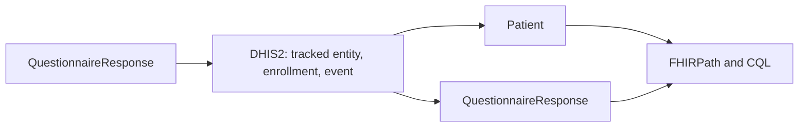

# Round trip

**Who this is for:** the developer who wants to see FHIR go into DHIS2 and come back out as FHIR.

**Before you start:** [Receive captures](build-receive-captures.md) and
[Read forms and people](build-read-forms-and-people.md).

**You will be able to:**

- commit a capture into DHIS2, rather than validate it
- read what DHIS2 now holds as FHIR
- ask FHIRPath and CQL questions of what came back

**The runnable version of this page** is
[`step11_round_trip.py`](https://github.com/winterop-com/dhis2w-fhir/blob/main/examples/facade/step11_round_trip.py).
It is the one step in the path that writes. It registers one made-up person with one visit and deletes them afterwards.
DHIS2 keeps a hidden copy of a deleted record, so run it against a demo instance.



## FHIR in

A registration and a visit go into the spool, and a drain commits both. A visit names the person it belongs to, so the
second `synthesize` adopts the person the first receipt registers.

```python
registration_form, visit_form = facade.forms()[:2]
seed = draw_seed()

registration = facade.synthesize(registration_form, seed=seed)
facade.capture(registration.model_dump_json(exclude_none=True, by_alias=True).encode())
visit = facade.synthesize(visit_form, seed=seed)
facade.capture(visit.model_dump_json(exclude_none=True, by_alias=True).encode())

report = await facade.drain(import_responses=True)
```

A fresh seed gives each run its own identifiers, because DHIS2 never lets a deleted identifier be used again. In a real
service the responses arrive from whoever submits them, and `synthesize` is not involved.

## FHIR out

```python
entity = await fetch_tracked_entity(facade.client, tracked_entity_uid)
record = await fetch_tracked_entity_record(facade.client, tracked_entity_uid)

index = TrackedEntityIndex.from_store(facade.project, facade.store)
published = next(kind for kind in index.tracked_entity_types if kind.uid == entity.trackedEntityType)
person = registered_entity_for(entity, index, published.resource_type)

projection = RecordProjection(
    naming=facade.naming,
    store=facade.store,
    indexes=facade.indexes,
    timezone=facade.project.config.generate.timezone,
)
visits = projection.project(record, record.events).responses
```

| What you sent | What comes back | What it holds |
| --- | --- | --- |
| A registration | The resource the guide maps that tracked entity type to, here a `Patient` | The attributes DHIS2 declares unique as `identifier`, and every attribute value as an extension |
| A visit | A `QuestionnaireResponse` | The answers, on the same form you submitted against |

**A visit comes back in the shape it went in,** because the form a capture is checked against is the form its event is read
back through. **A person does not.** DHIS2 holds a person as attribute values, so a `Patient` has no `name` or `birthDate`
unless a project nominates them under `[ips.identity]`: see
[`identity_nominations.py`](https://github.com/winterop-com/dhis2w-fhir/blob/main/examples/client/identity_nominations.py).

## Ask questions of it

Both evaluators read FHIR JSON, and neither knows the data came from DHIS2. FHIRPath asks the document you sent and the
document you got back the same question:

```python
ANSWERED_ITEMS = "QuestionnaireResponse.repeat(item).where(answer.exists())"

items = FHIRPathEvaluator().evaluate(ANSWERED_ITEMS, document)
```

The step exits with an error if an answer comes back changed, if a capture is refused, or if there was nothing to compare.
It compares one visit on one form, so it shows the path works rather than that every value type survives it.

CQL reads whatever the Bundle you give it holds, and here that is only what DHIS2 handed back:

```python
LIBRARY = """
library RoundTrip version '1.0'
using FHIR version '4.0.1'

define "People": Count([Patient])
define "Visits": Count([QuestionnaireResponse])
define "Completed Visits": Count([QuestionnaireResponse] Visit where Visit.status = 'completed')
"""

evaluator = CQLEvaluator(data_source=BundleDataSource(bundle))
evaluator.compile(LIBRARY)
evaluator.evaluate_definition("Completed Visits")
```

```console
$ uv run python examples/facade/step11_round_trip.py
into DHIS2: 2 spooled, 2 translated, 0 refused, 2 posted, 2 accepted, 0 rejected
read back: Patient/UiRBU1AL8R5 with 1 visit(s)
FHIRPath: 3 answers sent, 3 came back, 3 identical
FHIRPath: the person carries 2 attribute values
CQL: People = 1
CQL: Visits = 1
CQL: Completed Visits = 1
deleted UiRBU1AL8R5
```

[FHIRPath](501-fhirpath.md), [CQL](501-cql.md), and [quality measures](501-measures.md) cover what these can ask.

## Whose rights apply

**This page reads and writes as the connection's account.** Behind `mount_facade(app, read_as_caller=True)` the same round
trip runs as each caller: a capture posts at once under their credentials, and what they read back is what DHIS2 shows them.
See [Who can do what](build-who-can-do-what.md).

Next: [Mount the routes](build-mount-the-routes.md).
